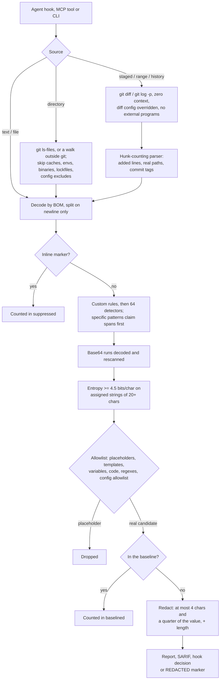

# mcp-secret-sentinel

<!-- mcp-name: io.github.AleBrito124356/mcp-secret-sentinel -->

[](https://github.com/AleBrito124356/mcp-secret-sentinel/actions/workflows/tests.yml)
[](pyproject.toml)
[](pyproject.toml)
[](LICENSE)

**Local secret guardrails for AI coding agents.** An MCP server, a CLI and agent hooks that catch API keys, tokens, private keys and passwords in code, commits, prompts, tool calls and MCP configs, before they leave the machine. 64 detectors, base64-aware, every finding redacted. No account, no network calls.

Secrets rarely leak through hackers; they leak through commits, and now through agents. GitGuardian's *State of Secrets Sprawl 2026* counted 28.65 million new secrets on public GitHub in 2025 (+34%), AI-service keys up 81%, 24,008 unique secrets in MCP configuration files, and a higher leak rate in commits co-written with AI coding assistants. A key pasted into `.mcp.json`, echoed by `cat .env` into a transcript, or written into a config by an agent in a hurry is compromised from that moment, even if the next commit deletes it.

Secret Sentinel puts a checkpoint at each of those moments:

| Moment | What stops it |
|---|---|
| The agent writes a key into a tracked file, a shell command or an MCP call | **Agent hook** denies the tool call (Claude Code, Codex, Cursor) |
| You paste a key into a prompt | **Agent hook** blocks the prompt before it reaches the model |
| A tool prints a key (`cat .env`, a config Read, a verbose log) | **Agent hook** replaces it with `[REDACTED:<detector>]` before the model sees it |
| A key sits in `.mcp.json`, `claude_desktop_config.json`, `CLAUDE.md`... | **`scan_agent_configs`** audits every MCP client and agent file, and flags the ones git tracks |
| A commit or a push is about to publish one | **`scan_git_staged` / `scan_git_range`**, the pre-commit hook and the GitHub Action |
| Logs or output have to be shared | **`redact_text`** masks every secret and keeps everything else |

The full secret value never appears in any output, so it never enters the conversation transcript either.

## Install

**Claude Code plugin** (skill + agent hooks + MCP server in one step):

```text
/plugin marketplace add AleBrito124356/mcp-secret-sentinel
/plugin install secret-sentinel@secret-sentinel
```

The hooks run straight from the plugin checkout with any Python 3.10+ (they use only the standard library). The MCP server starts with [`uv`](https://docs.astral.sh/uv/).

**MCP server only** (any MCP client):

```bash
claude mcp add secret-sentinel -- uvx mcp-secret-sentinel
```

```json
{
  "mcpServers": {
    "secret-sentinel": { "command": "uvx", "args": ["mcp-secret-sentinel"] }
  }
}
```

**CLI** (git hooks, CI, scripts): `pipx install mcp-secret-sentinel` or `pip install mcp-secret-sentinel`. To run the latest code from GitHub instead of PyPI, use `uvx --from git+https://github.com/AleBrito124356/mcp-secret-sentinel mcp-secret-sentinel`.

**Agent skill only** (Agensi, skills.sh, any agent that reads `SKILL.md`): the skill lives in [`skills/secret-sentinel`](skills/secret-sentinel/SKILL.md). It tells the agent when to scan, how to fix a finding and how to rotate a leaked credential, and uses the MCP tools or the CLI when they are available.

## Agent hooks

`mcp-secret-sentinel hook` reads one hook event as JSON on stdin and prints the agent's decision. The plugin wires it up for you; without the plugin:

```bash
mcp-secret-sentinel install-agent-hooks --agent claude              # .claude/settings.json (shared)
mcp-secret-sentinel install-agent-hooks --agent claude --scope local # .claude/settings.local.json
mcp-secret-sentinel install-agent-hooks --agent cursor              # .cursor/hooks.json
```

The installer merges into the existing settings and keeps every other hook. Running it again refreshes its own entries instead of duplicating them.

| Agent event | Behaviour |
|---|---|
| Claude Code / Codex `PreToolUse` on `Write`, `Edit`, `MultiEdit`, `NotebookEdit`, `Bash`, `PowerShell` and `mcp__*` tools | Denies the call when the new content, the command or the MCP arguments contain a secret (`permissionDecision: "deny"`, with the redacted reason and the fix). Writes to files git ignores (a local `.env`) and files outside any repository are allowed: that is where secrets belong. A tracked `.env` is still protected. Edits to `.secret-sentinel.toml`, the baseline or the `[tool.secret-sentinel]` table answer `"ask"`, so the guarded agent cannot quietly loosen its own guard. |
| `UserPromptSubmit` | Blocks the prompt and sets `suppressOriginalPrompt`, so the key is not echoed back into the block message. |
| `PostToolUse` on `Read`, `Bash`, `PowerShell`, `Grep`, `WebFetch` and `mcp__*` tools | Returns `updatedToolOutput` with the same shape and every secret replaced (a private key goes as a whole block, header to footer), plus a note telling the model not to try to recover it. |
| Cursor `beforeShellExecution`, `beforeMCPExecution`, `beforeReadFile`, `beforeSubmitPrompt` | `permission: "deny"` / `continue: false` with a redacted message. |

By default the hook blocks `high` and `critical` findings and lets `medium` ones (JWTs, high-entropy strings) through; `hook --fail-on medium` is stricter. Excluded paths in `.secret-sentinel.toml` are respected. The event is read as UTF-8 whatever the console code page, so accented project paths work on Windows. Anything unexpected (bad JSON, a broken config, an internal error) fails open with a non-blocking exit status, so the hook can never wedge the agent; a git failure other than "not a repository" keeps scanning on. Our own MCP tools are exempt, since they receive secrets on purpose.

## MCP tools

| Tool | Arguments | Returns |
|---|---|---|
| `scan_text` | `text`, `source_name="input"`, `max_findings=200` | Findings for a raw snippet (code, config, diff, logs) |
| `scan_file` | `path`, `max_findings=200` | Findings for one file; decodes UTF-8/16/32 by BOM, skips binaries and files over 5 MB |
| `scan_directory` | `path`, `max_files=500`, `max_findings=200` | Recursive scan. Inside git, the file list comes from git itself (every `.gitignore`, negations and global excludes honoured) |
| `scan_git_staged` | `repo_path`, `max_findings=200` | Only the lines added in `git diff --cached`: exactly what the next commit would publish |
| `scan_git_range` | `repo_path`, `base="@{upstream}"`, `head="HEAD"`, `max_commits=200`, `max_findings=200` | The commits in `base..head`: by default exactly what the next `git push` would publish |
| `scan_git_history` | `repo_path`, `max_commits=50`, `all_branches=false`, `max_findings=200` | Lines added by the last N commits (of HEAD, or every branch, tag and the stash), each tagged with its commit |
| `scan_agent_configs` | `project_path`, `include_user=true`, `include_transcripts=false`, `max_findings=200` | Audit of MCP client configs and agent instruction files (see below) |
| `redact_text` | `text` | `{"text", "redactions", "by_pattern"}`: the text with every secret replaced by `[REDACTED:<detector>]` |
| `list_patterns` | — | Active detectors with severity and remediation advice, plus the allowlist rules |

Every tool is annotated read-only (`readOnlyHint`, no open-world access), so clients can run them without a confirmation prompt. The scan tools publish an `outputSchema` and return `structuredContent` (MCP SDK 1.10+ / 2.x). The server also offers three prompts, `pre_push_check`, `leak_response` and `audit_agent_configs`, and a `secret-sentinel://patterns` resource.

All scan tools return the same shape:

```json
{
  "clean": false,
  "findings": [
    {
      "file": "config/notify.yaml",
      "line": 14,
      "pattern": "Slack incoming webhook",
      "severity": "high",
      "redacted": "hook…(77 chars)",
      "advice": "Anyone with this URL can post messages to your workspace. Regenerate the webhook in your Slack app settings and load the URL from an environment variable."
    }
  ],
  "files_scanned": 6,
  "summary": "Found 1 potential secret(s) across 6 scanned file(s): 1 high. Do NOT commit or push until these are removed or rotated."
}
```

`suppressed` is added when inline comments silenced findings, `baselined` when the baseline accepted some. **Bounded responses:** every scan lists at most `max_findings` findings (default 200, most severe first, `0` = no limit). When it has to cut, the report says `truncated: true` and keeps `total_findings`, `counts_by_severity`, `counts_by_pattern` and `top_files`, so a noisy tree cannot flood the agent's context.

### Auditing agent and MCP client configs

`scan_agent_configs` (CLI: `mcp-secret-sentinel agents [PROJECT]`) checks:

- **Project files**: `.mcp.json`, `.claude/settings.json`, `.claude/settings.local.json`, `.cursor/mcp.json`, `.vscode/mcp.json`, `.vscode/settings.json`, `.gemini/settings.json`, `.codex/config.toml`, `.windsurf/mcp.json`, `.amazonq/mcp.json`, `.kiro/settings/mcp.json`, `.roo/mcp.json`, `opencode.json`, and the agent instruction files `CLAUDE.md`, `CLAUDE.local.md`, `AGENTS.md`, `GEMINI.md`, `.cursorrules`, `.windsurfrules`, `.github/copilot-instructions.md`. Each one reports whether git tracks it.
- **User files**: Claude Code (`~/.claude.json`, `~/.claude/settings.json`, `~/.claude/CLAUDE.md`), Claude Desktop, Cursor, VS Code, Cline, Windsurf, Gemini CLI, Codex, Amazon Q, Kiro, Continue, Zed, opencode, Goose and LM Studio.
- **Session transcripts** (opt-in): the newest Claude Code and Codex `*.jsonl` logs. A key found there was also sent to the model provider.

Files with findings carry a `hint` on how that client references the environment instead of a literal, for example `"env": {"API_KEY": "${API_KEY}"}` in Claude Code's `.mcp.json` or `${input:...}` prompts in VS Code.

## What it detects

64 regex detectors, plus an entropy check and base64 decoding:

| Family | Detectors |
|---|---|
| AI and LLM | OpenAI (`sk-proj-`, `sk-svcacct-`, `sk-admin-`, legacy), Anthropic, xAI, DeepSeek-style `sk-<hex>`, Perplexity, OpenRouter, Groq, NVIDIA, Hugging Face, Replicate, Together AI, Cerebras, AWS Bedrock API keys |
| LLM tooling | LangSmith, Langfuse, Pinecone, Firecrawl, Tavily |
| Code hosting and packages | GitHub (`ghp_`, `gho_`, `ghu_`, `ghs_`, `ghr_`, `github_pat_`), GitLab (`glpat-`, `glptt-`, `gldt-`, `glrt-`), npm, PyPI |
| Cloud and infrastructure | AWS access keys and secret keys, Azure storage keys, Google API keys and OAuth client secrets, DigitalOcean, Cloudflare, Vercel, Supabase (`sb_secret_`, `sbp_`), Neon, PlanetScale, Fly.io, Databricks, HashiCorp Vault, Doppler |
| Payments, messaging, SaaS | Stripe live keys, Square, Shopify, SendGrid, Resend, Mailchimp, Twilio, Slack tokens and webhooks, Discord webhooks, Telegram bots, Linear, Notion, Atlassian, Postman, Sentry, Grafana, PostHog |
| Keys and tokens | Private key blocks (RSA, EC, DSA, OPENSSH, PGP, encrypted), `age` secret keys, JWTs |
| Credentials in URLs | Database and queue connection strings (Postgres, MySQL/MariaDB, MongoDB, AMQP, Redis) and `http(s)`/`ftp`/`smtp` URLs with `user:password@` |
| Generic | `password` / `secret` / `api_key` / `token`-style assignments in quoted code, and dotenv-style `UPPER_CASE=value` lines |

- **Entropy**: quoted strings of 20+ characters assigned to a variable, with an empirical entropy of at least **4.5 bits/char**, when no specific detector claimed the span.
- **Base64**: runs of 20+ base64 characters (standard or URL-safe) that decode to printable text are decoded once and scanned again, so a credential in a Kubernetes Secret manifest, a Basic auth header or an encoded PEM key is found. The finding is named after the inner detector with ` (base64)`.
- **Formats** come from the gitleaks, betterleaks and trufflehog rule sets. `sb_publishable_` keys, which are meant to be public, are not reported.

For credentials in URLs the reported value is the **password**, and the allowlist judges the password alone: `postgres://app:<literal>@${DB_HOST}/app` is still reported.

### What it deliberately ignores (allowlist)

Each candidate value is checked against these heuristics before being reported:

- **Too short**: values under 8 characters.
- **Masked**: values that are mostly (≥ 80%) `X`, `x`, `*` or dots, including vendor prefixes followed by an `XXXX…` run.
- **`example`**, **`placeholder`**, **`changeme`** and **your-…-here** markers, and `<angle brackets>`.
- **Templates**: `${VAR}`, `{{ jinja }}`, ``, `<%= … %>`, `#{…}`.
- **Variable references**: a value that is only `$UPPER_CASE_VAR`, `$(command)`, `$env:VAR` or `%VAR%`.
- **Format placeholders**: `%(name)s` or `{name}`.
- **Environment lookups**: values referencing `os.environ` or `process.env`.
- **Generic assignments and entropy only**: code rather than a literal (`os.getenv("X")`, `settings.DB_PASSWORD`, `SECRETS[0]`, one side of a concatenation), values shaped like a regular expression (`^(Write|Edit)$`, `[a-z]{32}`), plain links with no credentials, query or fragment, and filesystem paths (`C:\Users\...`, `~/...`, `/usr/local/...`), which fill agent configs. These rules never apply to vendor formats.
- **Reserved documentation hosts**: a credentialed URL pointing at `example.com` / `.net` / `.org`, `*.example` or `*.invalid`.

### Inline suppression

```python
TEST_DSN = "postgres://ci:ci-only-password@db:5432/test"  # secret-sentinel: ignore
```

detect-secrets' `pragma: allowlist secret` and gitleaks' `gitleaks:allow` work too, so files annotated for those tools need no changes. Markers are case-insensitive, cover only their own line, and apply to staged and committed lines. Suppressed findings are counted in `suppressed`, never hidden silently.

## Project configuration

`mcp-secret-sentinel init` writes a commented `.secret-sentinel.toml`. The same keys work in a `[tool.secret-sentinel]` table of `pyproject.toml`. The file is found from the scanned path upwards, stopping at the repository root, and applies to the CLI, the MCP tools and the agent hooks alike.

```toml
exclude_paths = ["tests/fixtures/**", "*.snap"]   # globs relative to this file; ** spans directories
allowlist = ["^sk_test_"]                         # regexes matched against the secret value
disable = ["JSON Web Token"]                      # detector names, "High-entropy string" included
baseline = ".secret-sentinel-baseline.json"       # optional

[[rules]]
name = "Acme internal token"
regex = 'acme_[a-f0-9]{32}'
severity = "critical"        # critical | high | medium
advice = "Revoke it in the Acme console."
```

Unknown keys, unknown detector names and invalid regexes are errors that name the file and the key, so a typo cannot silently weaken a scan. Custom rules run before the built-in detectors and show up in SARIF as their own rules.

### Baselines

Adopting a scanner on an existing repository usually means a few known findings (old test fixtures, revoked keys). Review them, then accept them:

```bash
mcp-secret-sentinel baseline          # writes .secret-sentinel-baseline.json
```

Later scans report only secrets that are not in the baseline, and count the rest in `baselined`. The file stores a **salted PBKDF2 fingerprint** of each value (never the value, never a fast hash), plus the file and line to help reviewers. Matching ignores the line, so an accepted value stays accepted when the code around it moves; private keys, whose detected header is the same for every key, are tied to their file name as well. The file is written where scans look for it: the config's `baseline` path, else the project root. Commit it; `scan --no-config` ignores it.

## Command line

`mcp-secret-sentinel` with **no arguments starts the stdio server**, so MCP client configs stay one word long. With a command it becomes a CLI:

```bash
mcp-secret-sentinel scan                       # the current directory
mcp-secret-sentinel scan src config/app.yaml   # files and directories
git diff | mcp-secret-sentinel scan -          # stdin
mcp-secret-sentinel scan --staged              # what the next commit would add
mcp-secret-sentinel scan --range               # what the next push would publish (@{upstream}..HEAD)
mcp-secret-sentinel scan --history 100 --all-branches
mcp-secret-sentinel scan --format sarif -o secrets.sarif
mcp-secret-sentinel redact app.log > app.redacted.log
mcp-secret-sentinel agents .                   # audit agent / MCP client configs
mcp-secret-sentinel install-hook               # git pre-commit hook
mcp-secret-sentinel install-agent-hooks --agent claude
mcp-secret-sentinel baseline
mcp-secret-sentinel init
mcp-secret-sentinel patterns                   # detectors, allowlist rules, suppression markers
```

```text
$ mcp-secret-sentinel scan src
src/billing.py:2  [critical] Stripe live key  sk_l…(32 chars)
    Roll the key in the Stripe Dashboard (Developers -> API keys). Live keys grant access to real payment data.
src/notify.py:3  [high] Slack incoming webhook  hook…(69 chars)
    Anyone with this URL can post messages to your workspace. Regenerate the webhook in your Slack app settings and load the URL from an environment variable.

Found 2 potential secret(s) across 2 scanned file(s): 1 critical, 1 high. Do NOT commit or push until these are removed or rotated.
```

| Option (`scan`) | Meaning |
|---|---|
| `--format text\|json\|sarif` | Human report (default), the MCP JSON report, or SARIF 2.1.0 |
| `--fail-on critical\|high\|medium` | Lowest severity that makes the exit status 1 (default `medium`, i.e. any finding) |
| `--max-findings N` | List at most N findings, most severe first (default 200; `0` = no limit; SARIF lists everything unless set) |
| `--max-files N` | Stop a directory scan after N files (default 5000) |
| `--max-commits N` | With `--range`: scan at most the N newest commits (default 200) |
| `--config FILE` / `--no-config` | Use a specific configuration, or ignore configuration and baseline |
| `--baseline FILE` | Accept the findings recorded in FILE |
| `-o, --output FILE` | Write the report to a file; the one-line summary goes to stderr |

**Exit status:** `0` clean (or only findings below `--fail-on`), `1` findings at or above `--fail-on`, `2` usage error (bad option, missing path, not a git repository, unknown revision, broken config). Output is redacted in every format.

### Block commits with a git hook

```bash
mcp-secret-sentinel install-hook            # in the repository, or: install-hook path/to/repo
```

This writes `.git/hooks/pre-commit` (or the directory `core.hooksPath` points at). The hook runs `scan --staged` with the Python that installed it, so a commit is refused while its staged lines contain a secret; `git commit --no-verify` skips it once. The installer never overwrites another tool's hook unless you pass `--force`, and then keeps the old one as `pre-commit.bak`.

With the [pre-commit](https://pre-commit.com) framework:

```yaml
repos:
  - repo: https://github.com/AleBrito124356/mcp-secret-sentinel
    rev: v0.3.0
    hooks:
      - id: secret-sentinel
```

### GitHub Action

```yaml
name: secrets
on: [push, pull_request]
jobs:
  scan:
    runs-on: ubuntu-latest
    permissions:
      contents: read
      security-events: write   # for the SARIF upload
    steps:
      - uses: actions/checkout@v4
      - uses: AleBrito124356/mcp-secret-sentinel@v0.3.0
        with:
          fail-on: high          # critical | high | medium
          # range: origin/main..HEAD   # scan only new commits (checkout with fetch-depth: 0)
          use-config: ${{ github.event_name != 'pull_request' }}  # a PR could edit the config
```

The action writes a redacted SARIF report to code scanning (one rule per detector, with `security-severity`), puts the text report in the job summary, and fails the step on findings at or above `fail-on`. A scan that cannot run (a bad range, a shallow clone, a broken config) fails with its own error instead of being reported as findings. `--format sarif` on the CLI produces the same SARIF 2.1.0 log for any other CI.

## How it works



### Encodings and line numbers

Files are decoded by byte-order mark (UTF-8, UTF-16 LE/BE, UTF-32) before the binary check, and BOM-less UTF-16 is recognised too, so the output of Windows PowerShell 5.1's `>` and `Out-File` is scanned instead of skipped. Lines are split on `\n` only, so form feeds, `\x85`, U+2028 and U+2029 inside a line never shift the reported line numbers.

### Redaction guarantee

Every finding shows at most the first 4 characters, and never more than a quarter of the value, plus the total length: `"hook…(77 chars)"`, `"Tr…(8 chars)"`. The full value never appears in the output, the transcript, hook decisions or logs. This is enforced in code (a single `redact()` choke point) and in the test suite, which asserts that raw values are absent from serialized results, hook decisions and real MCP stdio traffic, structured content included.

### Git scans read the text, not your diff settings

The git tools parse `git diff` / `git log -p` output, and local settings could change it: an external diff tool replaces the diff, `diff.mnemonicPrefix` or `diff.noprefix` corrupt the file names. Every git call therefore passes `--no-ext-diff --no-textconv --src-prefix=a/ --dst-prefix=b/ -U0 --inter-hunk-context=0 --no-color`, overrides `core.quotePath`, `core.fsmonitor`, `diff.noprefix`, `diff.mnemonicPrefix`, `diff.relative`, `diff.submodule`, `log.showSignature` and `log.showRoot` with `-c`, drops `GIT_EXTERNAL_DIFF` / `GIT_DIFF_OPTS`, takes no optional locks, closes stdin, and rejects revisions that start with `-`. The diff parser is a state machine driven by the hunk line counts, so an added line that reads `+++ something` is content, never a file header.

## Limitations

- **Regex detection, not verification**: findings are not checked against the provider (that would send your secrets over the network). Dedicated scanners such as gitleaks, betterleaks or trufflehog, with hundreds of rules and optional live verification, belong in your pipeline too; this is the fast local checkpoint an agent runs before the commit exists.
- **Outside git**, only simple root-`.gitignore` patterns apply (no negations, no `**`, no nested files). Inside a git work tree the file list comes from git and every rule applies.
- **Entropy needs diversity**: a candidate needs at least 23 distinct characters to clear 4.5 bits/char. Short random strings are covered by the regex detectors instead.
- **Unquoted generic assignments** are only detected in dotenv-style `UPPER_CASE=value` lines, a deliberate trade against false positives.
- **Line-by-line matching**: a secret split across lines is only caught by its first line (such as a `BEGIN PRIVATE KEY` header). Base64 is decoded one level deep.
- **Inline suppression is same-line only**, because in a zero-context diff the line above is usually not visible.
- **Merge commits are not diffed** (git's default for `git log -p`), so a secret introduced only while resolving a conflict is missed by the range and history scans; `scan_git_staged` still sees it before the merge commit is made.
- **Binary files in git are not scanned**; the summary lists them by name.
- **Cursor hook support** follows Cursor's published hook protocol; Claude Code's is covered by end-to-end tests over a real pipe.

## Development

```bash
git clone https://github.com/AleBrito124356/mcp-secret-sentinel
cd mcp-secret-sentinel
pip install -e ".[dev]"
python -m pytest
```

From the source tree, `python -m mcp_secret_sentinel` runs the CLI (the MCP server with no arguments). `core.py`, `config.py`, `agents.py` and `hooks.py` use only the standard library; `server.py` holds the MCP wiring.

The test suite never contains a realistic secret literal: every positive fixture is assembled at runtime by concatenation, and a test scans this repository and requires it to be clean. It covers every detector, the allowlist, base64 decoding, entropy, redaction, encodings, line numbers, git parsing against real repositories, the CLI as a subprocess, hook decisions (including through the plugin's shell launcher), the agent-config audit, configuration and baselines, and the MCP server over real stdio with the SDK's own client, structured output included. CI runs it on Linux, Windows and macOS, on Python 3.10 to 3.13, and on both majors of the MCP SDK.

## Related MCP servers

Part of a family of small, dependency-light MCP servers:

- [mcp-decision-lab](https://github.com/AleBrito124356/mcp-decision-lab): weighted decision matrices with sensitivity analysis
- [mcp-devils-advocate](https://github.com/AleBrito124356/mcp-devils-advocate): stress-test a claim with devil's advocate, premortem and assumption audits
- [mcp-git-historian](https://github.com/AleBrito124356/mcp-git-historian): churn hotspots, blame summaries, bus factor
- [mcp-memory-vault](https://github.com/AleBrito124356/mcp-memory-vault): persistent memory with SQLite FTS5 search

## License

MIT
